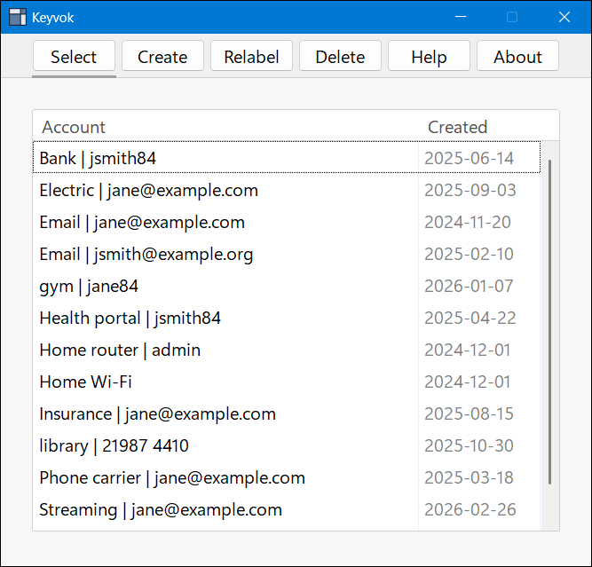
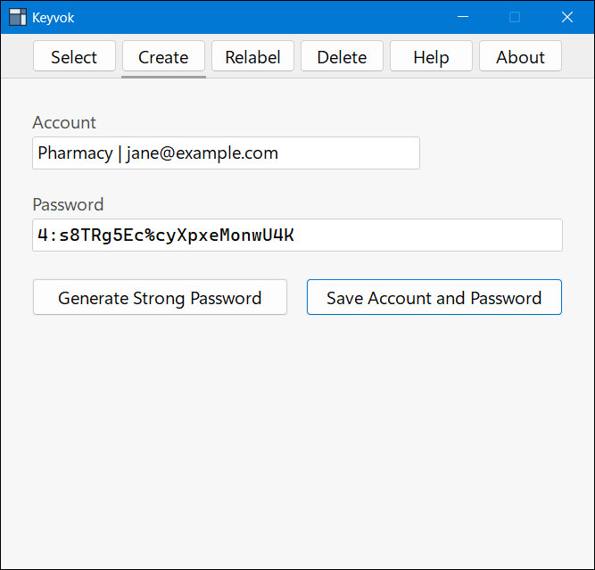

# Keyvok

An offline password vault for Windows. Label each account with its
service and username, such as `Bank | jsmith84`. Click an account to copy
its password, then paste it. The clipboard clears itself after 30 seconds.

<p>
  
  
</p>

## Features

- **One click to copy.** Select an account and its password is on the
  clipboard. It clears after 30 seconds, or right away when you press
  Escape. Copies are kept out of Windows Clipboard History (Win+V) and
  Cloud Clipboard.
- **Send a password to your phone.** Hold Alt while selecting an account
  to show its password as a QR code. Scan it with your phone's camera,
  then paste into the app or site that needs it. The code closes after 30
  seconds, or right away when you press Escape.
- **Strong generated passwords.** Each one has 24 characters with 143.8
  bits of entropy, drawn from Windows' system random number generator.
  Characters that are easy to confuse, such as 0 and O or 1 and l, are
  left out.
- **Full keyboard control.** See [Keyboard shortcuts](#keyboard-shortcuts).
- **Backup and moving computers.** Copy the encrypted passwords file for
  a backup, or export a CSV to move your passwords to a new computer and
  import them there.
- **Small and native.** A single 1 MB program written in C. It needs no
  runtime or other DLLs beyond those built into Windows, and it opens
  instantly.

## Security

Keyvok is offline by design. It contains no networking code, and there
are no accounts, no subscriptions and no telemetry.

Passwords are encrypted with Windows Data Protection (DPAPI) and kept in a
local SQLite database at:

```
%LOCALAPPDATA%\Programs\Keyvok\keyvok.db
```

Account labels and dates are not encrypted. If you'd rather not keep a
full username in the file, use a hint of it in the label instead.

DPAPI ties the encryption to your Windows sign-in. Only someone signed in
as you on this computer can decrypt the passwords. This has some
consequences:

- **Copies of the file are safe from others.** The passwords in a backup
  or a stolen copy of `keyvok.db` can't be read on another computer or by
  another Windows user.
- **Malware running as you can read your passwords.** It has the same
  access you do, so keep your security software up to date.
- **Backups of the file don't survive a Windows reinstall.** The file
  can't be decrypted after Windows is reinstalled or the motherboard is
  replaced. To keep a portable copy, export a CSV and store it somewhere
  safe, such as a flash drive. The CSV is not encrypted.

Passwords are decrypted only when they are needed, and the memory that
held them is wiped afterward.

## Download

Download the latest **Keyvok-Setup-x64.exe** from
[Releases](https://github.com/radiant-software/keyvok/releases/latest).
It runs on 64-bit Windows 10 or 11 and installs for the current user
without administrator rights.

The installer and the app are signed by Radiant Software LLC. To check a
download against the SHA-256 listed on its release page, run this in
PowerShell:

```powershell
Get-FileHash .\Keyvok-Setup-x64.exe -Algorithm SHA256
```

## Keyboard shortcuts

| Keys | Action |
| --- | --- |
| Alt+S, Alt+C, Alt+R, Alt+D, Alt+H, Alt+A | Go to Select, Create, Relabel, Delete, Help or About |
| Ctrl+Tab, Ctrl+Shift+Tab | Next or previous page |
| Up, Down, Page Up, Page Down, Home, End | Move through the account list |
| Type the start of a label | Jump to the first matching account |
| Enter or Space | Copy the highlighted account's password |
| Alt+Enter | Show the highlighted account's password as a QR code |
| Escape | Clear the clipboard or close the QR code |
| Ctrl+Q | Quit |

## Building from source

Keyvok is written in C and builds from WSL with clang-cl, using the MSVC
toolset and Windows SDK installed on the Windows side. It's tested with:

- LLVM 22 in WSL (`clang-cl-22` and `llvm-rc`)
- Visual Studio 2022 Build Tools, MSVC toolset 14.44.35207
- Windows 11 SDK 10.0.26100

The tool paths and versions are set at the top of the `Makefile`. Update
them if your installed versions or Visual Studio edition differ.

```sh
make          # build/release/keyvok.exe
make debug    # build/debug/keyvok.exe, with a console and CRT leak report
make test     # storage-layer tests
```

`keyvok.exe` opens the `keyvok.db` in its own folder, so a development
build never touches an installed copy's passwords.

The installer is built with [Inno Setup 6](https://jrsoftware.org/isinfo.php)
by `installer\build-installers.cmd`. It signs with Radiant Software LLC's
certificate, so to build an unsigned installer you'll need to edit the
script.

## Third-party code

- [SQLite](https://sqlite.org), public domain
- [QR Code generator library](https://www.nayuki.io/page/qr-code-generator-library)
  by Project Nayuki, MIT License

## Support

Report bugs and request features in
[Issues](https://github.com/radiant-software/keyvok/issues).
Report security problems privately through
[Security](https://github.com/radiant-software/keyvok/security).

## License

[MIT](LICENSE.txt), © 2026 Radiant Software LLC

"Keyvok" and the Keyvok logo are trademarks of Radiant Software LLC.
The MIT license covers the code, not the name or logo. If you
distribute a modified version, give it a different name and icon.
Official builds are signed by Radiant Software LLC and published only
on this repository's
[Releases](https://github.com/radiant-software/keyvok/releases) page.
